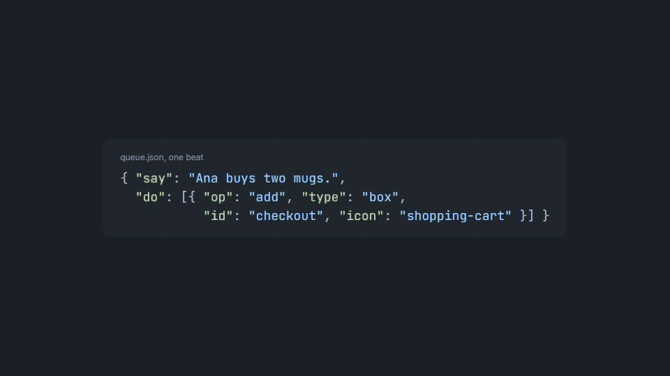

<p align="center">
  <picture>
    <source media="(prefers-color-scheme: dark)" srcset="assets/logo-dark.svg">
    
  </picture>
</p>

<p align="center">
  <b>Ask your agent how a system works. Get a two-minute narrated video back.</b><br>
  An agent-driven CLI that turns one JSON spec into a calm, visual explainer video: components, data flowing between them, one real example traced end to end, and a voice.
</p>

<p align="center">
  <a href="docs/overview.mp4"></a><br>
  <sub>▶ <a href="docs/overview.mp4">Watch the overview with sound</a> (2.5 min, made with unblackbox from <a href="docs/overview.json"><code>docs/overview.json</code></a>)</sub>
</p>

---

## Why

Reading a codebase tells you what each file does. It rarely tells you how the parts work together. unblackbox gives a newcomer that picture fast:

- **Systems, not functions.** Components with icons inside system boundaries, labelled arrows, packets that move along them.
- **One real example, end to end.** "Ana buys two mugs, order 1042", followed from the click to the receipt, through the failure and the fix.
- **Built on learning research.** About four things on screen at a time, problem before solution, one pause-and-predict question, no walls of text. `validate` checks these rules for you.
- **Fast.** The agent checks its work on a single contact-sheet image in about 5 seconds and renders only once.
- **Free voice.** [Kokoro](https://github.com/hexgrad/kokoro) runs locally. Paid providers plug in behind one interface.
- **Play with it.** On request, the same board becomes an interactive playground app: press "crash worker", watch the queue hold the order.

## How it works

```
 you ──"explain the checkout queue"──▶ agent ──reads──▶ skill (the video rules)
                                         │
                                       writes
                                         ▼
                                    queue.json ──▶ checker ─▶ voice ─▶ timeline ─▶ renderer ──▶ queue.mp4 + .srt
                                         ▲            │                                           (+ playground, on request)
                                         └── fixes ◀── still: every beat in one image, ~5 s
```

| part | file | what it does |
|---|---|---|
| Skill | [`skills/unblackbox/`](skills/unblackbox/SKILL.md) | tells the agent how to map a system and the rules a good video meets |
| Checker | [`src/spec.ts`](src/spec.ts) | zod schema, order checks (errors block) and research-backed lint (warnings advise) |
| Voice | [`src/tts.ts`](src/tts.ts) | Kokoro TTS, cached per sentence so edits only re-voice what changed |
| Timeline | [`src/timeline.ts`](src/timeline.ts) | pure function: spec + speech seconds → frame numbers for every element |
| Renderer | [`src/video/`](src/video) | Remotion + React draw each frame; Code Hike for the rare code glimpse |
| Playground | [`src/game.ts`](src/game.ts), [`play/`](play) | a prebuilt Tauri player that loads a game folder; no Rust compile per game |

## Install

You need Node 24 or newer and about 2 GB of disk (dependencies, the voice model, a headless browser). Playgrounds also need Rust. Install the plugin in your agent, then run its setup once; it installs the tool, puts `unblackbox` on your PATH and makes a test still.

### Claude Code

```
/plugin marketplace add RandomowyRandom/unblackbox
```
```
/plugin install unblackbox@unblackbox
```
```
/unblackbox:setup
```

Send each line as its own prompt. On Claude Code 2.1.275 or later the first two can be one: `/plugin install unblackbox --marketplace RandomowyRandom/unblackbox`. The desktop app's Code tab takes the same commands.

### Codex

```bash
codex plugin marketplace add RandomowyRandom/unblackbox
codex plugin add unblackbox@unblackbox
```

Then ask Codex to "set up unblackbox".

### GitHub Copilot CLI

```bash
copilot plugin marketplace add RandomowyRandom/unblackbox
copilot plugin install unblackbox@unblackbox
```

Then run `/unblackbox:setup`.

### Gemini CLI

```bash
gemini extensions install https://github.com/RandomowyRandom/unblackbox
```

Then run `/unblackbox:setup`.

### Any other agent with Agent Skills

Copy [`skills/unblackbox`](skills/unblackbox) and [`skills/setup`](skills/setup) into your agent's skills folder and ask it to "set up unblackbox". The setup skill clones the tool to `~/.unblackbox/app` when only the skill folders are present.

### By hand

```bash
git clone https://github.com/RandomowyRandom/unblackbox
node unblackbox/scripts/setup.mjs                # add --playground to build the playground player
```

Setup is safe to repeat. Run it again after updating the plugin: an update brings a fresh copy without dependencies.

## Use it

Ask your agent for a video:

> make a video explaining how our checkout queue works

The [`unblackbox` skill](skills/unblackbox/SKILL.md) takes it from there: map the system, write the spec, validate, check the contact sheet, render. `unblackbox guide` prints everything an agent needs in one go. Or drive it yourself:

```bash
unblackbox validate examples/queue-decoupling.json   # under 1 s: errors + warnings with paths
unblackbox still examples/queue-decoupling.json      # ~5 s: out/queue-decoupling-sheet.png, every beat in one image
unblackbox render examples/queue-decoupling.json     # out/queue-decoupling.mp4 + .srt
```

## A spec, in short

A video is a list of beats. Each beat pairs one sentence with what appears on screen while it is spoken:

```json
{
  "title": "Why put a queue between checkout and email",
  "beats": [
    { "say": "Ana buys two mugs. Checkout emails the receipt, then waits for the mail server.",
      "do": [
        { "op": "add", "type": "icon", "id": "ana", "icon": "user", "label": "Ana", "at": [2, 4.5] },
        { "op": "add", "type": "box", "id": "checkout", "label": "Checkout", "icon": "shopping-cart", "at": [7, 4.5] },
        { "op": "add", "type": "arrow", "id": "pay", "from": "ana", "to": "checkout", "label": "pay" },
        { "op": "trace", "ids": ["pay"], "label": "order 1042", "icon": "receipt" }
      ] }
  ]
}
```

Elements: `box`, `icon`, `group`, `cells`, `arrow`, `text`, `code`. Actions: `add`, `remove`, `move`, `trace`, `focus`, `camera`, `color`, `fill`, `morph`, `clear`. The full reference is [`AGENTS.md`](AGENTS.md) (also `unblackbox guide`), and `unblackbox schema` prints the exact JSON Schema.

## Commands

| command | what it does |
|---|---|
| `unblackbox guide` | the tool reference + the video rules |
| `unblackbox validate spec.json` | errors and warnings with paths, estimated length |
| `unblackbox still spec.json` | contact sheet of every beat (`--beat 3,7` for full-size frames, `--at 1.5` mid-beat) |
| `unblackbox render spec.json` | MP4 + SRT (`--beat 5,6` for a clip, `--out x.gif` for a GIF preview) |
| `unblackbox game topic.game.json` | build an interactive playground folder (~20 s) |
| `unblackbox play out/topic-play` | open it |
| `unblackbox voices` | list Kokoro voices |

Every command prints JSON to stdout, so agents can read the result.

## Playground

A playground is a small desktop app over the video's board: buttons trigger events, clicking a component explains it, with the same visuals and voice. Element colors are its state, so a crashed worker changes what the next order does.

```bash
node scripts/setup.mjs --playground                  # once; builds the player, needs Rust
unblackbox game examples/queue-decoupling.game.json  # ~20 s → out/queue-decoupling-play/
unblackbox play out/queue-decoupling-play            # or double-click the exe in that folder
```

## Repo map

```
src/                  the CLI: spec + lint, TTS, timeline, Remotion video, playground data
play/                 the playground runtime (React + @remotion/player) and its Tauri shell
skills/               the agent skills (unblackbox, setup) and the video rules
scripts/setup.mjs     one-time setup that /unblackbox:setup runs
.claude-plugin/ ...   plugin manifests: Claude Code, Codex (.codex-plugin, .agents), Copilot (.github/plugin), Gemini
examples/             a system video, a small code video, a playground
docs/                 this project's own overview video and its spec
reports/              the research the rules come from
test/                 node --test; the timeline is pure, so tests never open a browser
```

## Development

```bash
npm test
npm run typecheck
```

## Licensing note

unblackbox renders with [Remotion](https://www.remotion.dev), which is free for individuals and companies of up to 3 people; larger companies need a [Remotion company license](https://www.remotion.dev/license).
